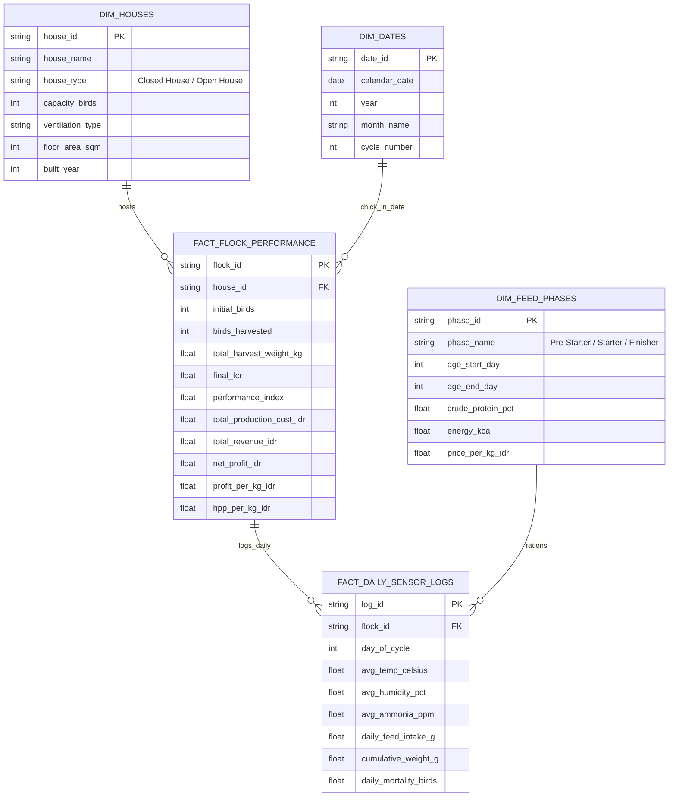

# Commercial Broiler Operations Hub — Precision Poultry Economics & Performance Index

[](https://wijaya-rama.github.io/portfolio-smart-broiler/)
[](Smart_Broiler_Story_Production.twbx)
[](LICENSE)
[](https://developer.mozilla.org/en-US/docs/Web/JavaScript)
[](data/)
[](data/)

> **Executive Commercial Poultry Management & Harvest Economics Dashboard** evaluating housing system efficiency, feed conversion ratios (FCR), microclimate thermoregulation, mortality financial timing, and European Performance Index (EPEF / IP) across **72 commercial flocks**, **1.78M harvested broilers**, and **4,031 metric tons** of live poultry produced in West Java (Subang & Sukabumi) across a 16-month operating cycle (January 2023 – April 2024).

[🚀 Launch Interactive Dashboard (Live Demo)](https://wijaya-rama.github.io/portfolio-smart-broiler/)

---

## Executive Summary

Commercial broiler production in tropical climates operates under tight margins dictated by feed conversion efficiency, heat dissipation capabilities, ventilation dynamics, and farmgate live-bird market volatility. Broilers lack functional sweat glands, making thermal control and effective airflow velocity decisive determinants of growth rate and flock livability.

This analytics project delivers an end-to-end quantitative comparison across **8 commercial houses** (H01–H04 Closed Tunnel Ventilation vs. H05–H08 Naturally Ventilated Open Houses) managing 72 flocks over 9 consecutive production cycles. The dataset reconciles daily IoT environmental telemetry (temperature, relative humidity, ammonia levels) with flock biological growth milestones and financial settlement ledgers.

The core commercial finding: **Closed House operations generated an audited margin advantage of +Rp 4,762 per kg live weight** (+Rp 3,696/kg in Closed vs. -Rp 1,066/kg in Open), driving an aggregate operating profit of **Rp 10.4 Billion** in Closed House units while Open House units accumulated **-Rp 1.31 Billion in operating losses**.

---

## Key Commercial Insights

```text
+----------------------------------------------------------------------------------------------------+
|                                    CORE COMMERCIAL TAKEAWAYS                                       |
+----------------------------------------------------------------------------------------------------+
| 1. HOUSING MARGIN SPREAD  : Closed House delivered +Rp 4,762/kg edge (+Rp 3,696 vs -Rp 1,066/kg)   |
| 2. PANTING TAX DRAG       : Open House finisher mean 32°C & >20 ppm NH3 burned feed without weight |
| 3. MORTALITY VALUE TIMING : Late loss (Day 22-35) costs 4x Week 1; Open lost 60.7% late (Rp 32k/hd)|
| 4. PERFORMANCE INDEX (IP) : IP >400 exclusively in Closed; Farmgate price drives margin variance   |
+----------------------------------------------------------------------------------------------------+
```

### 1. Housing Architecture & Margin Gap (+Rp 4,762/kg Live Weight Advantage)
* **Audited Margin Divergence**: Closed House flocks achieved an average net operating margin of **+Rp 3,696 per kg live weight**, whereas Open House flocks suffered an average net loss of **-Rp 1,066 per kg live weight**.
* **Driver Breakdown**: The spread of **Rp 4,762/kg** is driven by three primary compounding operational factors:
  1. **Feed Conversion Efficiency**: Closed House achieved an FCR of **1.405** compared to **1.827** in Open House (a 0.422 kg feed penalty per kg gain).
  2. **Harvest Finish Weight**: Closed House birds averaged **2.411 kg** in 35 days (99.6% of Cobb 500 standard) vs. **1.978 kg** in Open House (a 433 g deficit per bird).
  3. **Cumulative Mortality**: Closed House maintained a low depletion rate of **2.25%**, whereas Open House suffered **8.86%** mortality.

### 2. Thermoregulation & Microclimate Drag (The "Panting Tax")
* **Thermal Stress in Finisher Phase**: Daily mean temperatures in Open House averaged **32°C** during the critical finisher phase (Days 22–35), compared to **24°C** sustained inside evaporative-cooled Closed House facilities.
* **Feed Dissipation vs. Growth**: Under heat stress, broilers redirect dietary energy toward respiratory evaporative cooling (hyperventilation/panting) rather than skeletal muscle accretion. Despite consuming higher cumulative feed in the finisher stage (**2,382 g/bird** in Open vs. **2,203 g/bird** in Closed), Open House birds finished **433 grams lighter**.
* **Ammonia Toxicity Threshold**: Open House litter conditions caused ambient ammonia to breach the **20 ppm** respiratory threshold by **Day 17**, compromising mucosal lining and accelerating chronic respiratory distress.

### 3. Mortality Timing & Late-Phase Financial Drag (Day 22–35 Costs 4× Week 1)
* **Asymmetric Mortality Economics**: An early chick mortality (Days 1–7) costs only the initial Day-Old-Chick (DOC) procurement price of **Rp 8,000**. In contrast, a late finisher mortality (Days 22–35) destroys the DOC cost plus 2.2–2.5 kg of accumulated commercial feed, resulting in a loss of **~Rp 32,000 per bird**.
* **Mortality Volume Distribution**: In Open House, **60.7%** of all bird deaths occurred during the late finisher phase (**13,767 late deaths** out of 22,669 total deaths; averaging ~1,000 late dead birds per flock). Closed House experienced only **4,491 late deaths** across 36 flocks (~295 birds per flock).
* **Late Mortality Financial Loss**: Total late mortality losses reached **Rp 440.5 Million** in Open House compared to **Rp 143.7 Million** in Closed House.

### 4. Performance Index (IP >400 Exclusively in Closed) & Farmgate Price Volatility
* **Performance Index Stratification**: 100% of flocks achieving an IP rating above 400 ("Istimewa / Excellent") were Closed House flocks (averaging **IP 479.1**, with the highest flock reaching **484.8**). Open House flocks averaged **IP 282.1** ("Kurang / Underperforming").
* **Market Farmgate Price Impact**: Within the Closed House cohort, individual flock margins varied widely between **+Rp 2,638/kg** and **+Rp 4,925/kg**. Analysis reveals this variance was driven primarily by broader market live-bird price swings (**Rp 20,000 to Rp 22,000/kg**) rather than internal environmental management variations, demonstrating the critical impact of harvest timing and market cycles.

---

## Strategic Agribusiness Operating Moves

Based on comparative analysis across the 72 commercial flocks, three tactical operational interventions are recommended:

1. **Prioritize Retrofit of Open Houses H05 & H06 to Tunnel Ventilation**:
   * Both facilities were constructed in 2017 and currently run a **0.42 FCR penalty** against Closed House benchmarks.
   * Based on the reference configuration of H01 (8 tunnel exhaust fans for 1,920 m²), a 1,500 m² open house requires approximately 6–7 50-inch exhaust fans and evaporative pad cooling.
2. **Implement Automated Ammonia Alert at 15 ppm**:
   * Sensor triggers should activate exhaust fans at **15 ppm** before reaching the 20 ppm biological irritation threshold.
   * Closed House units already approach 15–17 ppm by Day 35, highlighting the need for continuous litter conditioning and ventilation cycling.
3. **Field Trial 20–25% Thinning (*Jarangan*) at Day 28–30 for Open House**:
   * Partial harvesting (thinning) 20–25% of flock biomass at 1.4–1.6 kg relieves pen density pressure before peak heat-stress days.
   * Recommended as an operational test across 2 trial flocks to measure net IP and FCR improvements.

---

## Data Architecture & Schema Design

The operational data model is organized into a clean Star Schema optimized for high-performance visual analytics:



### Dataset Summary

| Dataset File | Records | Primary Granularity | Purpose |
| :--- | :---: | :--- | :--- |
| [`data/poultry_operations_flat.csv`](data/poultry_operations_flat.csv) | **2,520 rows** | Flock-Day level (72 flocks × 35 days) | Denormalized master dataset with environmental telemetry, daily weights, and closeout economics |
| [`data/poultry_operations_star_schema.xlsx`](data/poultry_operations_star_schema.xlsx) | **5 Sheets** | Multi-table dimensional relational model | Enterprise Star Schema with fact tables and dimensional attributes |

---

## Dashboard Architecture & Engineering

The interactive presentation dashboard is built from the ground up as a lightweight, zero-dependency, standalone application (`index.html`) implementing the **Modern Minimalist Bento Grid** design standard:

* **Executive Bento Grid UI**: Four dedicated analytical tab modules:
  * `01 Executive Overview & Margin Gap`: High-level closeout summary, financial waterfall, and volume-weighted KPI cards.
  * `02 Feed & Microclimate`: Dynamic 35-day FCR curves, ambient temperature/humidity/ammonia correlation, and 3-phase nutritional breakdown.
  * `03 Growth & Mortality`: Daily weight trajectory vs. Cobb 500 benchmark, early vs. mid vs. late depletion financial impact table.
  * `04 Harvest Economics & PI`: Performance Index (IP) distribution, best vs. worst flock comparison cards, and operating moves.
* **Dual-Theme Engine (Light & Dark)**:
  * Light Mode: Pure clean background (`#F8FAFC`) with crisp card borders (`#E2E8F0`).
  * Dark Mode: High-contrast night palette (`#0B1120` canvas, `#162036` container surfaces) toggled via clean vector SVG switcher.
* **Live Dynamic Trajectory Charts**: SVG-rendered 35-day daily trajectories for weight and FCR calculated on-the-fly from active filtered records.
* **Cascading Filter Synchronization Engine**: Smart state synchronization between housing type and individual houses prevents 0-record filter deadlocks.
* **Bilingual Executive Support**: Instant toggle between English (`EN`, default) and Indonesian (`ID`) with re-evaluated narrative strings.

---

## Repository Structure

```text
portfolio-smart-broiler/
├── .gitignore                          # Standard git exclusion rules
├── LICENSE                             # MIT Open Source License
├── README.md                           # Executive documentation & operational insights
├── index.html                          # Interactive standalone web story dashboard
├── assets/                             # Supporting diagrams and design tokens
└── data/
    ├── poultry_operations_flat.csv     # Flat denormalized dataset (2,520 records)
    └── poultry_operations_star_schema.xlsx # Star schema relational model (Excel)
```

---

## How to Run the Dashboard

### Option 1: Direct Local Execution (Instant)
Simply double-click `index.html` in your file explorer to open the dashboard immediately in any modern web browser (Edge, Chrome, Firefox, Safari). No server or npm build steps required.

### Option 2: Run via Local Python Server
To preview under local web server conditions:
```bash
# Navigate to the repository directory
cd portfolio-smart-broiler

# Start local HTTP server
python -m http.server 8000
```
Open [http://localhost:8000](http://localhost:8000) in your browser.

### Option 3: Deploy to GitHub Pages (Free Cloud Hosting)
1. Push this repository to GitHub: `https://github.com/wijaya-rama/portfolio-smart-broiler`
2. Go to **Settings > Pages** in your GitHub repository.
3. Under **Branch**, select `main` and root `/ (root)`.
4. Click **Save**. The dashboard will be live at:
   `https://wijaya-rama.github.io/portfolio-smart-broiler/`

---

## Author & Attribution

* **Author**: Rama Wijaya (Livestock Enthusiast & Business Intelligence)
* **LinkedIn**: [Rama Wijaya](https://www.linkedin.com/in/ramawijaya1)
* **Portfolio**: [GitHub Profile](https://github.com/wijaya-rama)
* **Domain Focus**: Commercial Agribusiness Analytics, Financial Operations Modeling & Tableau Engineering

---

## License

This project is licensed under the [MIT License](LICENSE) — free for academic, commercial, and personal evaluation.
